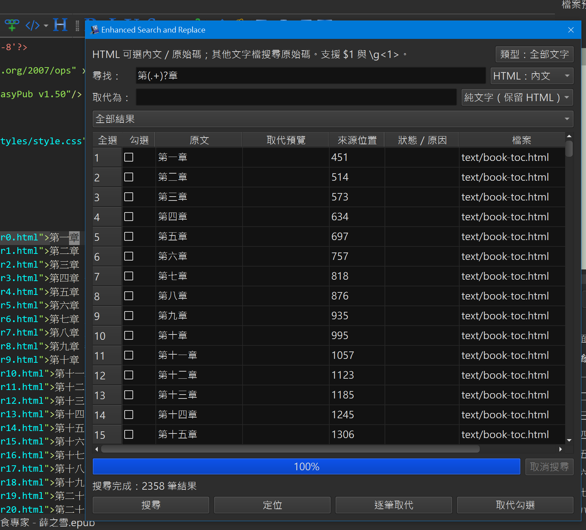

# Enhanced Search and Replace

版本：**1.2.0**；最低 calibre：**9.0.0**；作者：**SamLiao & Codex**。

`Enhanced Search and Replace` 是 calibre「編輯書籍」的增強搜尋與取代外掛。搜尋全書勾選的文字檔類型，以清單顯示命中內容及取代預覽，讓使用者逐筆或勾選批次處理。

## 功能

- 尋找旁提供檔案類型勾選選單，預設全選本書的文字類型，排除圖片、字型等二進位檔。
- HTML／XHTML 可選搜尋內文或完整原始碼（包含標籤與屬性）；OPF、XML、NCX、CSS、JS、TXT、JSON、SVG 等搜尋原始碼。
- 優先讀取已開啟分頁的未儲存內容，不必預先開啟章節。
- 使用 calibre Regex 引擎，支援原生 `\g<1>`、`\g<名稱>`，另外提供 `$1` 等數字群組引用。
- 取代欄旁可選「純文字（保留 HTML）」或「HTML 片段」，即時預覽並保留勾選。
- 點擊勾選欄左側、列號上方的左上角按鈕切換全選／全部取消；「勾選」標題不執行排序或全選，其他欄名可排序；欄寬可手動調整，預設視窗依字型保留約十五行結果的高度（受螢幕可用高度限制），單擊來源位置即可定位。
- 背景搜尋顯示目前檔案與進度，可取消；取消後保留已完整搜尋檔案的結果，未完成檔案不納入。
- 可篩選全部／待處理／已取代／失敗，點欄名切換升降冪排序，來源位置以數值排序。全選與勾選批次僅作用於目前可見列，隱藏列的勾選會保留。
- 逐筆取代後依目前畫面順序選到下一筆待處理結果；完成列保留並標示「已取代」，失敗列保留原因。
- 單檔操作沿用編輯器 Undo/Redo，跨檔批次使用 calibre 書籍復原點，失敗時嘗試整批回復。

## 操作畫面



使用者提供的實際操作畫面：預設顯示十五行結果，左上角「全選」切換可見列勾選；上方可選檔案類型與 HTML 搜尋方式，結果支援篩選、排序及單擊來源位置定位。

## 使用方式

1. 用 calibre「編輯書籍」開啟 EPUB，點擊外掛工具列或選單的 `Enhanced Search and Replace`。若工具列未顯示，可在編輯器偏好設定中加入該動作。
2. 輸入尋找內容，必要時在右側「類型」選單調整範圍，按「搜尋」。例如尋找 `第(\d+)話`。
3. 尋找旁可選「HTML：內文」或「HTML：原始碼」。在「取代為」輸入 `第$1章`，選擇取代模式，直接查看清單預覽。修改取代文字或模式不會清空結果；修改尋找式、HTML 搜尋方式或類型須重新搜尋。
4. 單選結果後按「逐筆取代」，或勾選所需結果後按「取代勾選」。成功與失敗均保留在清單，已完成列不能重複套用。
5. 單檔取代用編輯器 Undo/Redo；跨檔整批請用 calibre「復原至」。Ctrl+Z 只作用於目前編輯器。確認結果後自行儲存書籍，外掛不會自動存檔。

取代式錯誤只在清單標示；執行取代時，同一輪搜尋只告警一次。內容被另外修改、真正寫入或同步失敗仍會回報，避免使用過期位置。

## 取代模式與限制

- **純文字（保留 HTML）**：HTML 中的 `<`、`>`、`&` 視為文字；跨 inline 標籤時保留原標記、屬性及原位群組格式。例如 `第<span class="tcy">10</span>話` 可只將「話」改為「章」。群組重排／複製或無法判定新文字格式歸屬時拒絕，避免猜測格式。
- **HTML 片段**：可輸入 `<strong>第$1章</strong>` 等完整片段，群組文字自動跳脫；來源跨度與新片段皆須配對完整，寫入前再驗證整份 XML。命名空間前綴須於片段內宣告。
- 非 HTML 類型與 HTML 原始碼搜尋一律以原始碼取代，不做 HTML 跳脫，也不受右側片段模式影響；HTML／XHTML 原始碼模式照輸入逐字取代，允許暫時不完整的標籤，編輯完成後請使用 calibre 檢查書籍；XML／OPF／NCX／SVG 與 JSON 仍驗證完整輸出。CSS、JS 不做完整語法檢查，OPF 引用關係及 EPUB 內容模型也不在驗證範圍。
- 支援一般 XHTML DOCTYPE 與標準實體；不載入外部 DTD，含內部 DTD／自訂實體宣告、不合法 XML、非 NFC 輸出及跨區塊／零寬取代仍拒絕。
- 內文投影不模擬 CSS 渲染；排除 head、script、style、屬性及 CDATA。搜尋移至背景，結果按需顯示，預覽分批更新；Regex 每檔限時 2 秒，正在執行的 Regex 會等回傳或逾時後完成取消。讀取已開啟分頁時需要短暫擷取緩衝區；大量結果仍需要記憶體，取代與整份輸出驗證目前仍在視窗執行緒。
- 最低版本為安裝門檻；自動測試環境為 calibre 9.17。已以 Windows 真實 Edit Book 主視窗驗收搜尋、單筆 Undo/Redo、跨檔取代、WebEngine 預覽、原生儲存、正常退出及新程序重開。此驗收由測試程式操作真實控件，未涵蓋所有滑鼠／鍵盤流程；其他版本與平台仍未驗收。請先備份並在副本確認結果。

## 安裝

從 [本倉庫發行頁](https://github.com/SamLaio/calibreMetadatImplode/releases) 下載 `enhanced-search-and-replace.zip`，於 calibre「偏好設定 → 外掛 → 從檔案載入外掛」安裝並重新啟動「編輯書籍」。

若曾安裝 `Text Regex P0` 或「純文字搜尋取代」，先移除舊名稱外掛，避免同時載入。

## 原始 GitHub

本倉庫自行開發，沒有獨立上游；作者與授權沿用原始碼宣告及倉庫 GPLv3。API 參照 calibre 官方文件及固定版本原始碼，來源與驗證範圍見 [API_REPORT.md](API_REPORT.md)。

## 結構

- `src/`：外掛入口、視窗、搜尋取代核心及圖示。
- `fixtures/`、`tests/`：測試內文及七組自動驗證。
- [CHANGELOG.md](CHANGELOG.md)：更新紀錄。
- [TEST_PLAN.md](TEST_PLAN.md)：驗證紀錄及尚待人工驗收項目。

## 打包

在倉庫根目錄執行：

```powershell
python build_release.py
```

發布 ZIP 輸出到 `dist/enhanced-search-and-replace.zip`，外掛入口與模組位於 ZIP 根目錄。此指令會重新產生所有外掛的發行附件。
