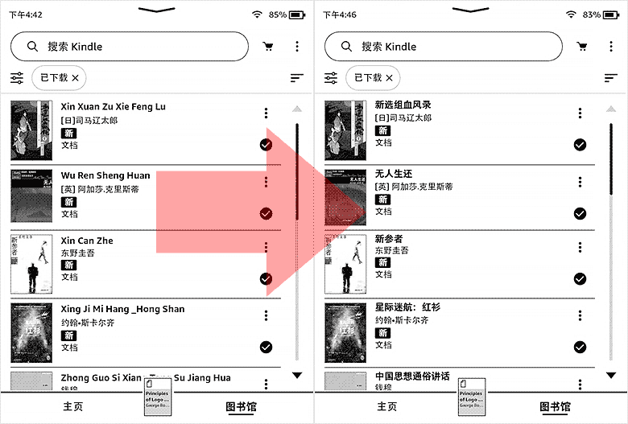

# Send to Kindle

版本：**v1.1.1_r.1**；calibre 外掛清單顯示的數字版本為 **1.1.1**，最低 calibre 為 **2.0.0**。

這個外掛會把選取的電子書透過 calibre 的電子郵件設定寄到 Kindle，並讓你在送出前修改書名與附件檔名。

## 安裝

1. 從 [本倉庫發行頁](https://github.com/SamLaio/calibreMetadatImplode/releases) 下載 `Send to Kindle-zh_TW-release.zip`。
2. 在 calibre「偏好設定 → 外掛 → 從檔案載入外掛」選擇 ZIP，安裝後重新啟動 calibre。
3. 若工具列沒有顯示外掛，請至「偏好設定 → 工具列與選單」加入 `Send to Kindle`。

上游官方 1.1.1 不含本倉庫的寄送檔名模板修正。從原始碼打包時，請在本倉庫根目錄執行 `python build_release.py`，產物位於 `dist/Send to Kindle-zh_TW-release.zip`。

## 使用方式

1. 先在 calibre 的電子郵件分享設定填妥寄件資訊與 Kindle 收件地址。
2. 選取要寄出的電子書，開啟 `Send to Kindle`。
3. 在寄送頁面雙擊書名，輸入本次要使用的名稱。
4. 在外掛設定頁勾選收件人，確認寄送格式與「寄送後從書庫刪除」選項，再按下寄送按鈕。

寄送工作可在 calibre 的「工作」清單查看。本次輸入的書名用於附件命名，不會因此改寫書庫書名。

## 寄送檔名模板

目前程式讀取 calibre 的 `mtp_devices` 設定中 `send_template` 值；若未設定，使用 `{title} - {authors}`。這是目前實作使用的模板來源，並非所有裝置各自保存的模板。

模板使用 calibre 欄位語法，代入書庫中繼資料；其中 `{title}` 使用本次寄送頁面輸入的書名。

| 模板 | 檔名示例 |
| --- | --- |
| `{title} - {authors}` | `新書名 - 王小明.epub` |
| `{id} - {title}` | `123 - 新書名.epub` |

書名與作者會保留原始中文，不轉拼音或 ASCII。模板若包含子目錄，電子郵件附件只使用最後一層檔名；副檔名依實際寄送格式而定。

## 上游與授權

- [bookfere/Send-to-Kindle-Calibre-Plugin](https://github.com/bookfere/Send-to-Kindle-Calibre-Plugin)，截至 2026-10-23 官方最新正式版為 1.1.1。
- [作者說明](https://bookfere.com/post/1042.html)
- [GNU General Public License v3.0](https://www.gnu.org/licenses/gpl-3.0.en.html)
