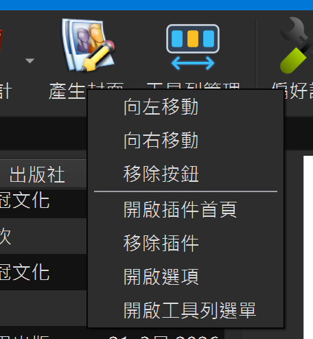

# Toolbar Manager（工具列管理）

作者：**SamLiao & Codex** · 版號：**1.0.0** · 授權：GPL v3  
來源：本專案自行開發，沒有獨立上游。適用於 calibre **9.17 以上**。

按鈕圖示以三個工具列按鈕搭配左右箭頭，表示調整工具列順序。

## 功能與使用

安裝後重新啟動 calibre，在工具列按鈕上按右鍵，即可依按鈕類型使用：

- **向左移動／向右移動**：調整目前工具列的按鈕順序，立即儲存並套用。
- **移除按鈕**：只從目前工具列移除，外掛仍保留安裝。
- **開啟插件首頁**：外掛提供有效首頁網址時顯示；本專案外掛另有首頁對照。
- **移除插件**：只對第三方外掛顯示，位於「開啟插件首頁」下方。先顯示名稱與確認對話框，預設為取消；確認後透過 calibre 移除外掛，完成後需重新啟動 calibre。
- **開啟選項**：外掛提供設定介面時顯示。
- **開啟工具列選單**：開啟 calibre 原有的「工具列與選單」設定。

按鈕原有的功能選單保留在「原有功能選單」子選單中。工具列空白處按右鍵可開啟工具列設定；搜尋列支援其外掛按鈕的右鍵操作。

此外，可在「偏好設定 → 工具列與選單」加入「工具列管理」按鈕，點選直接開啟工具列設定；不加入此按鈕也能使用右鍵功能。

## 安裝與注意事項

使用「偏好設定 → 外掛 → 從檔案載入外掛」安裝 `Toolbar Manager-zh_TW-release.zip`，再重新啟動 calibre。

移動或移除按鈕只影響目前位置，其他工具列不變；移除後可從 calibre 工具列設定加回。外掛保護最後一個「偏好設定」及裝置「位置管理」入口，並遵守 calibre 的按鈕移除限制。

「移除插件」會解除安裝外掛，與「移除按鈕」不同。此功能不主動刪除外掛設定檔或書庫資料；其他外掛本身的解除安裝行為由 calibre 與該外掛決定。未知首頁的外掛不顯示「開啟插件首頁」。

## 打包與驗證

於專案根目錄執行 `python build_release.py`，安裝包輸出至 `dist/`。程式碼位於 `src/`，測試位於 `tests/`。

已使用 calibre 9.17 的 Qt 環境進行 19 項隔離測試，包括移動與移除、必要入口保護、設定回復、右鍵選單順序、搜尋列按鈕及移除確認／取消／失敗。移除外掛的實際呼叫使用替身測試，未解除安裝使用者的外掛；仍需在正常 calibre 視窗確認實際操作效果。
